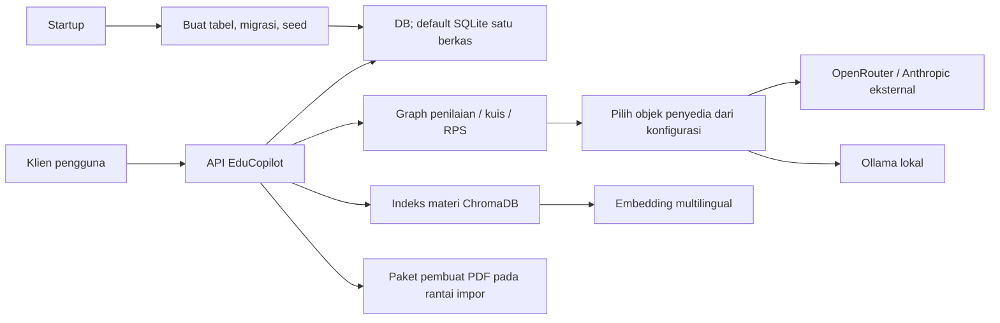
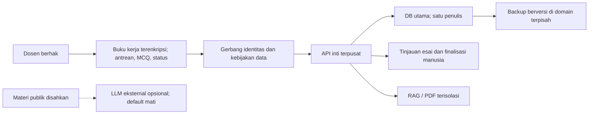
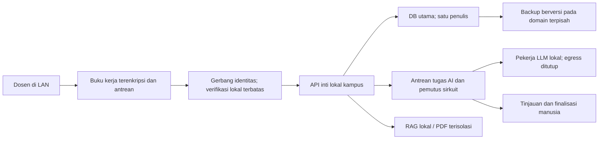
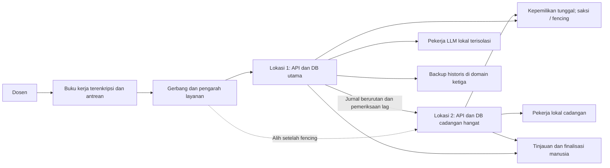

# Rancangan resiliensi EduCopilot — tugas 7, Tahap 6

Status: rancangan awal, 6 November 2026. Kebutuhan prodi belum diketahui. Seluruh target, kapasitas, biaya, daya, durasi skenario, bobot, dan skor di bawah adalah **asumsi untuk pengambilan keputusan**, bukan kebutuhan yang telah disahkan atau hasil pengukuran. Belum ada eksperimen gangguan yang dijalankan dalam pekerjaan ini. Angka hasil hitung hanya membuktikan konsistensi model asumsi.

Acuan utama adalah `docs/10-TradeOff_Resiliensi.pdf`, disebut **S** diikuti nomor slide: S9 untuk syarat gugur; S17–19 untuk fungsi minimum, kegagalan bersama, dan skenario; S30–35 untuk indikator, RTO/RPO, energi, matriks, sensitivitas, dan Pareto; S37–41 untuk alternatif, eksperimen, tata kelola, dan asesmen. `docs/Panduan Tugas Mahasiswa GanAI - SO.pdf` halaman PDF 10–11, tugas 7, mengharuskan tiga alternatif, empat dimensi perbandingan, sedikitnya dua eksperimen, versi konfigurasi, dan kesimpulan berbukti. Kedua PDF dibaca memakai `pdftotext -layout`; tidak mengambil angka contoh slide sebagai target EduCopilot. `docs/analisis-gap-ganai.md` bagian 5.12, 5.12a, dan 5.16 menjadi daftar pemeriksaan; klaim kodenya diperiksa kembali terhadap berkas saat penulisan.

Jejak pemeriksaan: HEAD awal `a005dec2bf710a139f56bdfa143feace15a6477f`, branch saat dibaca `test/alat-uji`; branch tidak diganti. **Semua rujukan kode `file:baris` dalam dokumen ini merujuk snapshot commit tersebut**, disebut baseline, bukan salinan kerja yang terus berubah. Saat pembacaan awal, isi 30 berkas sumber cocok persis dengan snapshot itu; hash agregatnya diverifikasi ulang melalui objek Git. Thread lain mengubah salinan kerja selama penulisan, sehingga temuan baseline tidak boleh dianggap otomatis masih berlaku pada kode terbaru. “Kondisi saat ini” di bagian 4 berarti kondisi baseline pada awal kajian. Untuk memeriksa rujukan, gunakan `git show a005dec2bf710a139f56bdfa143feace15a6477f:<path>` tanpa checkout, kemudian nomor baris; skrip bagian 6 melakukan pemeriksaan yang sama.

SHA-256 PDF slide: `e4d3575f0fd10699add2b597db0e2c1995f03a4541dd7454da7fbee7eb3a3bfa`; PDF panduan: `91726fc590ac033773c606734853926506654e732496125f8046293e6f987ec5`. SHA-256 agregat 30 berkas baseline: `7c4dcc3ddad2b8cbc70d045fd5a63eed3da30bc906a38cab9fe19d6fc3a21b70`. Cara menghitung agregat tersedia dalam skrip bagian 6. Tidak membaca rahasia `.env`, menjalankan aplikasi, mengubah kode/data, atau mengklaim hasil thread lain.

## 1. Pengguna, fungsi kritis, layanan minimum, batas kualitas, dan dependensi

### 1.1 Batas layanan dan pengguna

Kasus ini adalah layanan AI pendukung pengajaran. Pengguna langsung **diasumsikan dosen/pengelola mata kuliah**: ada operasi membuat kuis manual dan mengunggah jawaban CSV (`backend/app/api/v1/quiz.py:105-131`, `backend/app/api/v1/quiz.py:404-409`), serta pemicu penilaian per kuis (`backend/app/api/v1/grading.py:14-16`). Ini inferensi peran dari operasi, bukan bukti kebutuhan lapangan atau otorisasi pengguna.

**Mahasiswa adalah pihak terdampak**, karena model submission menyimpan identitas, jawaban, nilai, dan umpan balik (`backend/app/models/submission.py:18-30`). Endpoint daftar submission mengembalikan data tersebut (`backend/app/api/v1/quiz.py:389-399`); keberadaan endpoint tidak membuktikan portal mahasiswa. **Pemilik layanan, operator, dan pengelola data prodi** adalah peran organisasi usulan untuk menyetujui batas mutu dan menangani insiden, bukan peran yang sudah terbukti berjalan.

Batas rancangan mencakup klien dosen, API, penyimpanan akademik, indeks materi, jalur AI, backup, dan prosedur manusia. Kegagalan yang dibahas meliputi jaringan eksternal, proses, penyimpanan, model, dan operator. Sistem akademik kampus dan akses dari perangkat pribadi belum dipetakan. Saat seluruh lokasi dan perangkat pengguna kehilangan daya, target beralih ke prosedur manual; ketersediaan digital tidak dijanjikan.

### 1.2 Fungsi dan mutu minimum

Penentuan kritikalitas mengikuti dampak yang tidak dapat diterima pada S17. Semua dampak dan batas pada tabel ini **asumsi**, perlu divalidasi prodi. Status minimum adalah **usulan**, bukan perilaku aplikasi saat ini.

| ID | Fungsi dan bukti kode | Dampak yang diasumsikan tidak dapat diterima | Layanan minimum dan batas kualitas usulan |
|---|---|---|---|
| FK1, kritis | Simpan/baca jawaban dan nilai: `backend/app/api/v1/quiz.py:503-527`, `backend/app/models/submission.py:18-30` | Jawaban hilang tanpa diketahui, nilai tertukar, atau pemulihan memakai data contoh | Setiap penerimaan memiliki ID dan bukti simpan; bedakan antrean lokal dari commit server. RPO bencana penyimpanan ≤5 menit; semua selisih diketahui dan direkonsiliasi dari bukti unggah. Tidak boleh reseed diam-diam. |
| FK2, kritis | Penilaian pilihan ganda deterministik: `backend/app/agents/grading_agent.py:46-70`; esai memanggil LLM: `backend/app/agents/grading_agent.py:111-119` | Gangguan teknis menjadi nilai akademik final atau kesimpulan kelemahan mahasiswa | Pilihan ganda tetap dapat dihitung; esai gagal menjadi `perlu_tinjau`, nilai final kosong, nilai parsial dipisah. Dosen memutuskan finalisasi dan dapat merevisi dengan jejak audit. Setiap esai diverifikasi manusia; target antrean tinjauan selesai ≤2 hari kerja. |
| FK3, penting | Analitik berbasis DB/statistik: `backend/app/api/v1/dashboard.py:364-380`, `backend/app/core/stats.py:244-260` | Angka lama atau nilai parsial dianggap hasil final | Tampilkan waktu sumber, versi data, status parsial, dan jumlah esai tertunda. Usia data normal ≤5 menit; setelah itu penanda kedaluwarsa wajib. Saat gangguan boleh tampil snapshot hanya baca berlabel. |
| FK4, dapat ditunda | Kuis manual: `backend/app/api/v1/quiz.py:105-131`; jalur generasi menjalankan graph: `backend/app/api/v1/quiz.py:56-71` | Kegiatan terhenti hanya karena AI tidak tersedia | Kuis/manual rubrik dan impor jawaban tetap tersedia melalui API atau paket lokal terkendali; generasi AI boleh ditunda sampai ≤1 hari kerja setelah dependensi pulih. |
| FK5, dapat ditunda | Katalog pemeriksaan deterministik: `backend/app/core/sndikti_catalog.py:710-730`; draf RPS memakai LLM: `backend/app/agents/rps_agent.py:255-257`, `backend/app/agents/rps_agent.py:359-370` | Draf gagal menggantikan jadwal yang sudah sah | Versi lama tetap terbaca; hasil AI harus lolos validasi dan persetujuan sebelum mengganti versi. Katalog lokal tetap dapat dipakai; generasi ditunda seperti FK4. |
| FK6, tambahan | Pencarian RAG: `backend/app/api/v1/knowledge.py:243-257`; materi pascakuis: `backend/app/api/v1/grading.py:105-120`; PDF: `backend/app/api/v1/dashboard.py:453-479` | Kegagalan tambahan merambat ke FK1/FK2 | Boleh tidak tersedia dengan alasan jelas; status indeks harus berdasarkan keberhasilan, bukan keberadaan teks. Pemulihan ≤1 hari kerja sesudah fungsi kritis pulih. |

Asumsi beban untuk desain: satu prodi, 1.000 submission/bulan, 100 submission dalam satu batch, dan 10 sesi dosen bersamaan. Untuk penerimaan minimum saat offline, sediakan buffer terenkripsi 256 MiB per unit layanan, batas 1.000 rekaman berukuran maksimum 64 KiB, faktor ruang 2: `1.000 × 64 KiB × 2 = 125 MiB`, di bawah kapasitas usulan. Kapasitas ini untuk jawaban dan metadata, **bukan lampiran materi besar**. Target durasi offline 8 jam; pada rekaman ke-900 tampilkan peringatan, pada kapasitas aman hentikan penerimaan baru dengan pesan dan pertahankan berkas sumber. Tidak ada jaminan laju penerimaan aktual sebelum diuji. Kunci jawaban dan paket lokal hanya boleh diakses dosen berhak.

### 1.3 Dependensi nyata dan titik kegagalan

| Dependensi | Bukti yang diperiksa | Implikasi dari pembacaan kode; belum diuji |
|---|---|---|
| Konfigurasi LLM, pustaka penyedia, kredensial, koneksi | Urutan baku `openrouter,anthropic,ollama`: `backend/app/core/config.py:39-43`; builder cloud: `backend/app/core/llm.py:31-63`, `backend/app/core/llm.py:66-92`; builder lokal: `backend/app/core/llm.py:95-108` | `get_llm` mengembalikan objek pertama yang dapat dibuat (`backend/app/core/llm.py:132-140`), bukan failover setelah panggilan gagal. Builder Ollama tidak memeriksa kesehatan server sebelum mengembalikan objek. Timeout/retry aktual SDK belum diukur. |
| SQLite dan media penyimpanan | Default URL satu file: `backend/app/core/config.py:25`; engine/sesi: `backend/app/core/database.py:6-20` | Default satu berkas adalah titik kegagalan data. Lingkungan aktual dapat mengganti URL; rancangan ini tidak menganggap default sebagai bukti konfigurasi produksi. |
| Inisialisasi, migrasi, seed | Startup: `backend/app/main.py:38-40`; pembuatan tabel dan seed: `backend/app/core/database.py:23-40`; seed kursus/mahasiswa: `backend/app/seed.py:29-35` | DB yang hilang berisiko digantikan DB baru dan data contoh pada startup. Ini inferensi jalur kode, bukan restore yang sudah diuji. Modul inisialisasi tersebut tidak memperlihatkan prosedur backup/restore. |
| ChromaDB, model embedding, disk/cache model | Lokasi indeks dan embedding: `backend/app/core/rag.py:7-17`; pencarian: `backend/app/core/rag.py:35-46` | Kesiapan cache model untuk offline belum diketahui. Indeks dapat dibangun ulang dari teks sumber, tetapi waktu dan kelengkapannya belum diukur. |
| Indeks materi dan pelaporan status | Kegagalan indeks ditangkap: `backend/app/api/v1/materials.py:28-48`; status ditulis sebelum indeks: `backend/app/api/v1/materials.py:170-179`; pencarian gagal menjadi HTTP 500: `backend/app/api/v1/knowledge.py:248-257` | Penyimpanan materi dapat berhasil walau indeks gagal; label “Terindeks” belum cukup menjadi bukti kesiapan pencarian. |
| Parser PDF dan pembuat PDF | Ekstraksi memakai PyPDF2 dan menangkap exception: `backend/app/api/v1/materials.py:138-146`; impor reportlab: `backend/app/services/pdf_generator.py:1-5` | Ekstraksi gagal dapat menghasilkan teks kosong. Rantai impor `backend/app/main.py:4` → `backend/app/api/v1/dashboard.py:6` → layanan PDF membuat paket PDF juga menjadi dependensi startup, bukan hanya fungsi ekspor. |
| API, kontrak data, transaksi | Router: `backend/app/main.py:20-35`; filter submission belum dinilai: `backend/app/api/v1/grading.py:24-30`; simpan hasil dan commit: `backend/app/api/v1/grading.py:73-98` | Batch mengandalkan satu proses API dan DB. Commit setelah loop memberi hipotesis bahwa interupsi sebelum commit tidak menyimpan hasil batch; perlu uji, bukan klaim atomisitas menyeluruh. |
| Manusia dan jaringan/daya | Pemicu penilaian HTTP: `backend/app/api/v1/grading.py:14-16`; unggah CSV: `backend/app/api/v1/quiz.py:404-409` | Kehadiran dosen/operator diasumsikan penting untuk memicu, memeriksa, dan memulihkan. Topologi jaringan/daya aktual tidak terbukti dari kode. Dua proses pada listrik atau disk yang sama bukan diversifikasi (S18). |

Privasi: payload esai memasukkan teks jawaban sampai 1.500 karakter (`backend/app/agents/grading_agent.py:80-108`). Tidak memasukkan kolom NIM/nama secara eksplisit **tidak membuktikan anonim**, karena teks bebas dapat berisi identitas. Materi pascakuis juga mengirim rerata kelas dan topik kelemahan (`backend/app/agents/auto_material_agent.py:125-158`). Gerbang privasi harus mencakup data turunan, prompt, indeks, dan log.

## 2. Persyaratan wajib dan preferensi

Sesuai S9, persyaratan wajib diperiksa **sebelum** matriks. Seluruh W berikut adalah kandidat kebijakan rancangan, belum disahkan prodi. Untuk perbandingan sementara, diperlakukan sebagai wajib; jika kampus menetapkan batas berbeda, seleksi diulang. Privasi data mahasiswa yang dikirim ke LLM eksternal adalah **kandidat syarat gugur**, bukan bonus skor dan bukan pernyataan hukum.

| ID | Kandidat wajib dan cara membuktikan | Kondisi kode saat ini / dasar kebutuhan |
|---|---|---|
| W1 | Hanya dosen berhak pada mata kuliah terkait dan operator terbatas dapat mengakses identitas/nilai. Uji akses tanpa identitas, lintas mata kuliah, dan sesi kedaluwarsa; hasil harus ditolak. | Route daftar mahasiswa hanya menunjukkan dependensi sesi DB (`backend/app/api/v1/students.py:40-55`); pendaftaran router dan middleware yang terlihat tidak menambahkan autentikasi (`backend/app/main.py:10-35`). Perlindungan pada deployment di luar kode belum diketahui; jangan menganggap CORS sebagai otorisasi. |
| W2 | Tidak ada jawaban, identitas, nilai individual, atau data turunan mahasiswa ke LLM eksternal. Data bebas yang klasifikasinya ragu ditolak. Bukti: kebijakan egress, pemeriksaan seluruh panggilan, dan uji penanda sintetis, termasuk jalur materi pascakuis. | Risiko nyata pada prompt esai dan materi pascakuis di bagian 1.3. Hanya materi publik yang disahkan dapat masuk jalur cloud opsional; tanpa bukti klasifikasi jalur ditutup. Menghapus NIM saja tidak memenuhi W2. |
| W3 | Gangguan AI tidak menghasilkan nilai final nol; manusia dapat meninjau/merevisi, hasil parsial tidak masuk analitik final. Uji exception dan keluaran invalid serta audit revisi. | Fallback esai memberi 0 (`backend/app/agents/grading_agent.py:120-130`); agregasi memasukkannya (`backend/app/agents/grading_agent.py:156-166`); API menyimpan score dan status `graded` (`backend/app/api/v1/grading.py:73-75`). Ini bertentangan dengan target usulan. |
| W4 | Penerimaan jawaban minimum dapat dilanjutkan selama offline eksternal 8 jam dengan buffer bagian 1.2; status antre/sudah commit jelas, replay ber-ID unik tidak menggandakan data. Uji kapasitas, durasi, dan sinkronisasi. | Impor saat ini bergantung DB API dan melewati NIM yang sudah ada (`backend/app/api/v1/quiz.py:448-471`, `backend/app/api/v1/quiz.py:503-527`). Itu belum membuktikan buffer offline atau idempotensi konkuren. |
| W5 | RTO layanan minimum ≤30 menit dari awal dampak; RPO kehilangan penyimpanan utama ≤5 menit; backup konsisten di domain kegagalan terpisah dan restore benar-benar diuji. DB hilang harus menghentikan startup normal dengan status pemulihan, bukan seed otomatis. | Jalur startup dan seed ada pada bagian 1.3. Backup tidak cukup dibuktikan oleh adanya file (S24); replikasi tidak menggantikan backup historis. |
| W6 | Audit akses/perubahan/pemulihan, enkripsi salinan dan buffer, retensi, penghapusan terkendali, minimisasi data, dan verifikasi manusia sebelum publikasi nilai. Usulan retensi log audit 90 hari dan backup 30 hari; kunci terpisah. Uji akses dan keterlacakan tanpa merekam jawaban mentah. | Ada email opsional pada model (`backend/app/models/student.py:13-15`), endpoint hapus mahasiswa (`backend/app/api/v1/students.py:175-193`), serta pencatatan kegagalan penilaian via `print` (`backend/app/api/v1/grading.py:67-71`). Potongan ini tidak membuktikan audit/retensi yang memadai. |
| W7 | Status normal/terbatas/pemulihan dan kesegaran data terlihat; fungsi tambahan terisolasi. Data/draf lama tidak diganti oleh keluaran AI invalid. Uji kegagalan indeks, parser, LLM dan pemulihan versi. | Risiko label indeks di bagian 1.3. Parsing RPS gagal menghasilkan daftar kosong (`backend/app/agents/rps_agent.py:359-370`), jalur generate memanggil penggantian (`backend/app/api/v1/rps.py:485-495`) yang menghapus jadwal lama (`backend/app/api/v1/rps.py:80-83`). Jalur regenerate sudah menguji daftar tidak kosong (`backend/app/api/v1/rps.py:1353-1365`); tidak semua jalur setara. |

Preferensi yang dipertimbangkan sesudah layak: biaya lebih rendah, fungsi lebih banyak bertahan di atas minimum, energi lebih rendah per fungsi berguna, serta jam pemeliharaan lebih sedikit. Latensi di atas minimum dan kemampuan generatif tambahan dapat dipilih sesudah kebutuhan nyata diketahui. **Skor tinggi tidak mengompensasi pelanggaran W2 atau W3.** Prototipe saat ini tidak dimasukkan sebagai alternatif layak: pembacaan kode menunjukkan celah W3 dan W7, sementara W1/W2/W4–W6 belum terbukti terpenuhi.

## 3. Skenario gangguan yang dapat diuji

Seluruh durasi, beban, dan kriteria berikut adalah **asumsi uji**. Jalankan kelak hanya di lingkungan terisolasi dengan data sintetis, DB/indeks salinan, port dan direktori tersendiri. Jangan memutus jaringan host, menghentikan proses, atau menghapus DB workspace bersama. Kata “tanpa LLM berbayar” berarti tiruan deterministik atau model lokal yang sudah disiapkan; tidak berarti komputasi dan tenaga gratis.

| ID | Pemicu | Kondisi awal | Durasi dan cakupan asumsi | Fungsi | Kriteria penerimaan usulan | Tanpa LLM berbayar |
|---|---|---|---|---|---|---|
| G1 | LLM tiruan melempar exception koneksi/timeout; larang seluruh egress AI | 100 submission sintetis belum dinilai; tiap kuis mengandung pilihan ganda dan esai; rubrik/kunci tersedia | 10 menit gagal, lalu 20 menit observasi pulih; seluruh jalur LLM pada layanan uji | FK2, FK3, FK6 | Pilihan ganda sesuai kunci; esai `perlu_tinjau`, final kosong, analitik tidak menganggapnya final; pemberitahuan ≤60 detik; layanan minimum RTO ≤30 menit; retry terkendali tanpa duplikasi. Harus berlaku juga saat materi pascakuis mencoba AI. | Ya, tiruan gagal lalu sehat; tidak membutuhkan Ollama aktif |
| G2 | Tiruan menghasilkan teks bukan JSON, JSON tidak lengkap, lalu daftar kosong | RPS lama dan nilai lama memiliki manifest ID/hash; ada satu draf baru | 5 menit invalid + 10 menit pulih; endpoint generate dan regenerate diuji terpisah | FK2, FK5 | Tidak mengganti data lama; hasil ditolak dan beralasan; tidak memfinalkan nilai; jumlah/ID jadwal lama tetap. Prediksi risiko kode terdapat pada W3/W7. | Ya, tiruan |
| G3 | Hentikan proses pekerja uji di tengah batch | 100 submission, tiruan lambat deterministik, catat batch/ID/commit | Proses mati 2 menit + observasi 15 menit; hanya proses uji | FK1, FK2 | Tidak ada hasil final sebagian yang disamarkan lengkap; batch dapat dilanjutkan per ID; tidak ada penilaian ganda; seluruh perbedaan sebelum/sesudah dijelaskan. | Ya, tiruan |
| G4 | Karantina berkas DB uji setelah menghentikan proses; mulai ulang dan restore | Backup konsisten berumur ≤5 menit, manifest isi, catatan transaksi sesudah backup, runbook/kunci tersedia | Penyimpanan utama tidak tersedia sampai restore; anggaran 30 menit + 15 menit observasi; seluruh DB akademik uji | FK1–FK5 | Startup tanpa DB tidak menampilkan seed sebagai data asli; restore terverifikasi; RTO minimum ≤30 menit, RPO ≤5 menit; ID/hash/jumlah cocok untuk titik pulih, selisih sesudahnya tercatat, replay tanpa duplikasi. | Ya; jalur AI ditiru/dimatikan |
| G5 | Karantina direktori ChromaDB uji atau buat akses gagal; simulasi cache embedding tidak tersedia | Materi memiliki teks di DB dan indeks diketahui sehat | 15 menit rusak + 30 menit pembangunan ulang; hanya indeks/model embedding uji | FK6 | FK1/FK2 tetap tersedia; pencarian gagal dengan status jelas; label indeks tidak menyatakan siap; hasil reindeks cocok manifest materi, durasi dicatat. | Ya; embedding tiruan, lalu uji tambahan model lokal jika cache tersedia |
| G6 | CSV tanpa NIM, NIM asing, duplikasi, jawaban invalid, ukuran di atas batas | Kuis dan roster sintetis, jumlah submission awal diketahui | Satu batch 100 baris dalam jendela 10 menit; jalur impor | FK1, FK2 | Baris invalid dilaporkan; NIM asing dikarantina untuk pemeriksaan; unggah ulang tidak menggandakan; data sah tidak berubah; batas ukuran menolak secara jelas. Validasi saat ini di `backend/app/api/v1/quiz.py:437-471`, status asing di `backend/app/api/v1/quiz.py:490-501`. | Ya |
| G7 | Putus jalur WAN eksternal pada namespace uji, LAN tetap hidup | Paket lokal, otorisasi offline terbatas, buffer kosong, snapshot bertimestamp | 8 jam, 1.000 rekaman maksimum sesuai bagian 1.2; hanya unit uji | FK1–FK4 | Rekaman lokal lengkap dan terenkripsi; antre ≠ commit; paket pilihan ganda/manual dapat dipakai; status kedaluwarsa jelas; replay ber-ID dan urutan versi tanpa duplikasi; selisih nol setelah sinkronisasi. | Ya |
| G8 | Hilangkan domain daya/lokasi utama secara simulasi, lalu putus hubungan antar-lokasi | Alternatif C, cadangan siap, kunci dan health check tersedia | 15 menit hilang lokasi + 15 menit partisi; dua lokasi uji | FK1–FK3 | Pengambilalihan hanya oleh satu penulis; RTO target C ≤5 menit, RPO ≤5 menit; saat kepemilikan ambigu, hentikan tulis server dan antre lokal. Tidak boleh dua nilai final berbeda. | Ya, simulasi proses/jaringan; bukan bukti ketahanan listrik fisik |

Dua eksperimen yang diprioritaskan: **G1 dan G4**, karena menguji keputusan akademik saat AI gagal serta keselamatan data/pemulihan. G7 diperlukan untuk membuktikan W4 sebelum operasional; dua eksperimen minimum tugas belum cukup membuktikan semua W. Model drift, mutu pedagogis, keterbatasan operator, kehilangan kunci, dan padam berkepanjangan memerlukan pengujian/observasi lanjutan.

## 4. Kondisi saat ini dan tiga alternatif arsitektur

### 4.1 Diagram kondisi saat ini

Diagram ini menggambarkan dependensi kode, **bukan topologi deployment yang telah diobservasi**. Sumber hubungan API–DB: `backend/app/core/database.py:10-20`; API–graph: `backend/app/api/v1/grading.py:46-68`; graph–LLM: `backend/app/agents/grading_agent.py:111-119`; routing: `backend/app/core/llm.py:132-140`; materi–indeks: `backend/app/api/v1/materials.py:28-48`; indeks–embedding: `backend/app/core/rag.py:13-17`; impor PDF saat startup: `backend/app/main.py:4`, `backend/app/api/v1/dashboard.py:6`.



Hubungan graph kuis/RPS dengan LLM diperiksa pada `backend/app/agents/quiz_agent.py:107`, `backend/app/agents/quiz_agent.py:176`, `backend/app/agents/rps_agent.py:255-257`. Belum ada bukti pengalihan penyedia setelah kegagalan `invoke`; diagram tidak menganggap urutan konfigurasi sebagai failover operasional.

### 4.2 Paket wajib bersama untuk A, B, dan C

Semua komponen berikut adalah **usulan yang belum diimplementasikan/diverifikasi**. Ketiga alternatif mencakupnya, sehingga layak **secara rancangan bersyarat**. Tidak ada yang dinyatakan siap produksi.

1. Gerbang identitas, otorisasi per mata kuliah, enkripsi, audit, retensi/penghapusan, dan pengelolaan kunci. API langsung dibatasi jaringan agar tidak melewati gerbang. Paket offline memakai kewenangan lokal bertanda tangan dengan masa berlaku usulan maksimum 8 jam; sesudah kedaluwarsa hanya prosedur manual terkendali.
2. Kebijakan keluar data tertutup: alur data mahasiswa hanya lokal/lingkungan institusi. Jalur eksternal default mati. Materi publik boleh diproses terpisah setelah klasifikasi dan pengesahan; data agregat kelas tetap dianggap data mahasiswa. Log hanya ID samaran, status, hash, waktu, dan kategori galat; jangan merekam prompt/jawaban/kredensial mentah.
3. Buku kerja lokal terenkripsi yang menyimpan antrean, ID stabil, versi rekaman, urutan per submission, tanda terima, dan snapshot berlabel. Pembacaan ulang memverifikasi integritas. Penilaian pilihan ganda lokal/manual serta esai manusia menjaga minimum; finalisasi perlu pemeriksaan manusia. Buku kerja ini perlu dibangun dan diuji, tidak disamakan dengan fitur impor yang sudah ada.
4. Status `diterima_lokal`, `tersimpan_server`, `perlu_tinjau`, `final`, `gagal` dengan transisi tervalidasi. Nilai parsial terpisah dari final; finalisasi idempoten berdasarkan submission dan versi rubrik. Galat AI tidak diterjemahkan menjadi 0. Draf RPS memakai validasi dan penyimpanan versi sebelum pertukaran; modul PDF/RAG terisolasi dari inti.
5. Backup konsisten minimal tiap 5 menit ke media/domain terpisah, terenkripsi dan berversi selama asumsi 30 hari; manifest ID/hash dan waktu commit. Gunakan mekanisme snapshot DB konsisten, jangan menyalin SQLite yang sedang ditulis tanpa koordinasi. Startup produksi gagal aman jika DB wajib hilang. Restore harus diverifikasi sebelum trafik tulis dibuka; backup meliputi konfigurasi/schema dan sumber materi, indeks boleh dibangun ulang.
6. Deteksi, pemberitahuan, runbook pemulihan, dan rekonsiliasi replay. Satu penulis aktif, pembatasan ukuran/antrean, timeout usulan 30 detik, maksimum satu retry sebelum dialihkan ke manusia, pemutus sirkuit selama 60 detik. Retry memakai ID sama; efek samping tidak boleh terulang. Angka ini target rancangan, bukan konfigurasi SDK saat ini.

### 4.3 Alternatif A — layanan terpusat dan penilaian esai manual

Satu server institusi terpusat menyimpan data; dosen mengakses melalui jaringan kampus/WAN. Pilihan ganda deterministik; esai dinilai manusia sepanjang waktu. Tidak ada LLM pada alur data mahasiswa. Pembuatan materi publik melalui cloud bersifat opsional dan dimatikan dalam perbandingan biaya/energi. Buku kerja lokal menjaga penerimaan dan penilaian minimum saat server/WAN terganggu. Backup terpisah dipulihkan manual; ketergantungan operator lebih tinggi.



Konsekuensi: sederhana dan hemat perangkat, tetapi mode minimum lebih sering bergantung buku kerja serta operator; fungsi server penuh tidak bertahan ketika WAN/server pusat gagal. Manual esai menjadi titik kapasitas. A bukan cloud yang mengirim jawaban mahasiswa: desain seperti itu gugur W2.

### 4.4 Alternatif B — layanan lokal kampus dengan LLM lokal opsional

API inti, DB, paket materi, embedding yang telah di-cache, dan model lokal tersedia di LAN unit kampus. Putus internet eksternal tidak memutus fungsi inti LAN. Pekerja AI berada di proses terpisah dengan batas sumber daya; kegagalan atau model tidak layak mengembalikan esai ke manusia. Tidak ada klaim bahwa model lokal setara kualitas cloud. Backup terpisah dan buku kerja lokal tetap wajib karena satu host utama masih titik gagal.



Konsekuensi: fungsi LAN lebih kontinu saat internet gagal; perlu daya, RAM, cache model, dan pengelolaan versi lokal. LAN, host, dan listrik unit masih risiko bersama; backup di rak yang sama tidak memenuhi domain terpisah. Jika perangkat lokal atau tenaga operator tidak memadai, manfaat B berkurang.

### 4.5 Alternatif C — layanan lokal dengan cadangan lintas lokasi

B mengembangkan cadangan hangat di lokasi institusi berbeda dengan sumber daya/jaringan terpisah, bukan menggandakan proses pada host yang sama. Tulis hanya di satu primary. Replikasi/jurnal berurutan target lag ≤5 menit; pengambilalihan memerlukan fencing atau penguncian kepemilikan yang teruji. Tidak mengusulkan berbagi berkas SQLite aktif lewat jaringan. Pilihan mekanisme DB/replication harus ditentukan dan diuji pada implementasi; biaya migrasi/kompetensinya dimasukkan dalam anggaran asumsi. Backup historis tetap terpisah dari replikasi.



Konsekuensi: target pengambilalihan lebih cepat untuk satu lokasi gagal; energi, perangkat, biaya, serta pemeliharaan meningkat. Partisi yang membuat pemilik tulis ambigu harus menghentikan tulis server dan memakai antrean lokal. Layanan identitas, kunci, DNS, dan saksi juga perlu akses cadangan; satu ketergantungan bersama dapat meniadakan manfaat lokasi kedua (S18).

### 4.6 Gerbang kelayakan sebelum skor

| Wajib | A | B | C | Bukti yang masih harus dikumpulkan |
|---|---|---|---|---|
| W1 | Gerbang dan kewenangan offline terbatas | Sama, verifikasi lokal | Sama, tersedia di kedua lokasi | Uji otorisasi dan pemulihan identitas |
| W2 | Tanpa AI untuk data mahasiswa | Model institusi lokal, egress tertutup | Model institusi pada dua lokasi, egress tertutup | Pemeriksaan aliran data dan uji penanda sintetis |
| W3 | Esai selalu manusia | AI hanya draf; final manusia | Sama dengan B | Exception/JSON invalid, analitik parsial, audit revisi |
| W4 | Buku kerja lokal | LAN ditambah buku kerja lokal | Dua lokasi ditambah buku kerja lokal | G7 dan uji penuh kapasitas |
| W5 | Backup terpisah, restore ≤30 menit | Backup terpisah, restore ≤30 menit | Cadangan ≤5 menit dan backup historis | G4, tambahan G8 untuk C |
| W6 | Paket wajib bersama | Paket wajib bersama | Paket wajib bersama pada dua lokasi | Uji kunci, akses log, retensi dan hapus |
| W7 | Status/versioning/isolasi | Sama | Sama, termasuk status replikasi | G2/G5 dan pemeriksaan UI |
| Keputusan | Layak secara rancangan bersyarat | Layak secara rancangan bersyarat | Layak secara rancangan bersyarat | **Belum satu pun lulus uji operasional** |

Jika gerbang, buku kerja, backup, atau pengendalian nilai dihilangkan demi biaya murah, alternatif tersebut **gugur** dan tidak boleh memakai skor bagian 6. Jika kebijakan prodi melarang seluruh LLM termasuk lokal, B/C hanya layak setelah model dinonaktifkan dan biaya/skor dihitung ulang. Jika minimum yang disahkan mengharuskan seluruh fungsi otomatis tetap tersedia saat WAN/host gagal, A dan mungkin B gugur; matriks ini tidak berlaku.

## 5. Perbandingan biaya, kontinuitas, energi, dan pemeliharaan

### 5.1 Batas perbandingan dan model asumsi

Semua alternatif melayani beban yang sama dari bagian 1.2, termasuk penyimpanan aman, penilaian pilihan ganda, dan tinjauan manusia; fitur generatif tambahan tidak dihitung sebagai keberhasilan minimum. Asumsi unit fungsi berguna: **satu submission lengkap dengan jawaban tersimpan, nilai final disahkan manusia, dan jejak audit**. Angka 1.000 unit/bulan hanya penyebut perencanaan; jika esai belum ditinjau, unit belum selesai dan energi per unit aktual meningkat.

Semua rupiah berikut **anggaran internal hipotetis**, bukan harga pasar, tarif listrik resmi, penawaran pemasok, atau harga API. Tidak ada harga penyedia LLM yang dikutip. Cloud opsional dimatikan; jika diaktifkan untuk materi publik, biaya dan energi cloud belum diketahui dan harus ditambahkan sebelum membandingkan. Daya adalah alokasi rata-rata hipotetis seluruh infrastruktur yang dihitung, termasuk porsi backup, jaringan dan cadangan; bukan TDP perangkat atau pengukuran listrik.

| Masukan asumsi | A | B | C | Dasar penetapan asumsi |
|---|---:|---:|---:|---|
| Anggaran awal perangkat, konfigurasi, pengamanan dan kompetensi | Rp9.600.000 | Rp24.000.000 | Rp96.000.000 | Skenario anggaran: satu pusat sederhana; satu unit lokal dengan AI; dua lokasi, mekanisme DB, fencing, dan migrasi. Belum ada rincian penawaran. |
| Amortisasi untuk skor bulanan | 24 bulan | 24 bulan | 24 bulan | Periode analitis sama; bukan umur nyata perangkat |
| Pemeliharaan teknis per bulan | 4 jam | 8 jam | 16 jam | A: patch/backup 2 + akses/audit 1 + latihan restore 1. B: dasar A 4 + model/cache 2 + validasi/antrean 2. C: dasar B 8 + replikasi/fencing 4 + dua lokasi/latihan 4. |
| Tinjauan esai dan administrasi per bulan | 20 jam | 20 jam | 20 jam | 1.000 submission × asumsi 1,2 menit. Tidak mengasumsikan penghematan manusia dari AI; untuk esai panjang angka ini mungkin terlalu kecil. |
| Nilai per jam kerja | Rp50.000 | Rp50.000 | Rp50.000 | Nilai bayangan tenaga, bukan upah/kontrak terverifikasi |
| Daya rata-rata infrastruktur | 30 W | 80 W | 140 W | Hipotesis kapasitas relatif; seluruh jalur cadangan ikut dialokasikan |
| Waktu energi per bulan | 720 jam | 720 jam | 720 jam | Asumsi 30 hari × 24 jam |
| Nilai energi untuk anggaran | Rp1.500/kWh | Rp1.500/kWh | Rp1.500/kWh | Koefisien anggaran internal; bukan klaim tarif yang berlaku |
| Operasi penyimpanan/koneksi tambahan per bulan | Rp100.000 | Rp100.000 | Rp100.000 | Alokasi penyederhanaan sama; dapat meremehkan biaya lintas lokasi C |

Rumus asumsi: `E_i = P_i × 720 / 1.000` kWh/bulan. `O_i = (H_pelihara,i + 20) × 50.000 + E_i × 1.500 + 100.000`. Biaya bulanan untuk skor `C_i = I_i/24 + O_i`. Kas siklus hidup asumsi 36 bulan `T_i = I_i + 36 × O_i`, tanpa diskonto, inflasi, nilai jual, atau penggantian. Jangan menghitung amortisasi lagi dalam T. Pengadaan pengganti dan akhir penggunaan belum diestimasi; prioritaskan guna ulang perangkat, penghapusan media aman, dan pencatatan limbah pada pembaruan biaya siklus hidup (S14).

| Hasil hitung atas asumsi | A | B | C |
|---|---:|---:|---:|
| Energi infrastruktur/bulan | 21,6 kWh | 57,6 kWh | 100,8 kWh |
| Operasi termasuk tenaga/bulan, O | Rp1.332.400 | Rp1.586.400 | Rp2.051.200 |
| Biaya ekuivalen bulanan, C | Rp1.732.400 | Rp2.586.400 | Rp6.051.200 |
| Kas siklus hidup asumsi 36 bulan, T | Rp57.566.400 | Rp81.110.400 | Rp169.843.200 |
| Energi per unit berguna pada 1.000 unit/bulan | 21,6 Wh | 57,6 Wh | 100,8 Wh |
| Pemeliharaan teknis/bulan | 4 jam | 8 jam | 16 jam |

Energi perangkat klien, bangunan, perjalanan operator, produksi perangkat, dan jaringan di luar alokasi tidak dihitung. Batas yang sama dipakai untuk ketiganya, tetapi akibat manusia/manual belum tercakup penuh. Ukur kelak energi stopkontak/telemetri alokasi idle dan beban, durasi, jumlah unit selesai, serta energi klien jika berbeda. Energi inferensi lokal harus termasuk pengukuran host; jangan menambah perkiraan token di atas energi host yang sama.

SCI **belum diukur/dihitung numerik**. Bentuk rencana sesuai S32: `SCI = (E × I_karbon + M_teralokasi) / R`, dengan batas sistem sama, intensitas karbon listrik yang dapat diverifikasi, emisi tertanam perangkat yang dialokasikan selama pemakaian, dan R unit berguna yang benar-benar selesai. E lebih kecil belum membuktikan emisi atau keberlanjutan total lebih kecil; data karbon dan umur perangkat belum tersedia.

### 5.2 Kontinuitas dan konsekuensi keberlanjutan

Kontinuitas dinilai sebagai kemampuan **di atas minimum W**, bukan persentase availability yang dibuat-buat. Rubrik asumsi skor: 1 = gagal layanan minimum (gugur); 2 = minimum melalui buku kerja/manual, server dipulihkan ≤30 menit; 3 = sebagian operasi server lokal bertahan saat WAN putus; 4 = seluruh fungsi inti LAN bertahan saat WAN/LLM gagal, tetapi satu host tetap perlu restore ≤30 menit; 5 = kemampuan skor 4 ditambah pengambilalihan satu lokasi gagal ≤5 menit. Skor ditetapkan dari kemampuan yang dirancang, **belum diuji**: A=2, B=4, C=5. Kemampuan C saat partisi tetap dibatasi satu penulis; bukan kontinuitas tanpa batas.

| Dimensi | A | B | C |
|---|---|---|---|
| Kontinuitas asumsi | Buku kerja dan operator menahan gangguan; pusat/WAN masih titik gagal | LAN menahan putus internet; AI bisa ditunda; host/LAN/daya masih titik gagal | Diversifikasi lokasi menahan satu lokasi gagal; bergantung fencing, identitas dan jalur cadangan |
| Ekonomi | Anggaran terendah; biaya waktu manual berisiko naik | Anggaran sedang; kompetensi model lokal diperlukan | Anggaran tertinggi; layak hanya bila dampak gangguan membenarkan cadangan |
| Lingkungan | Alokasi energi/perangkat lebih rendah | Tambahan komputasi/model; peluang guna ulang perangkat | Dua lokasi dan perangkat cadangan menambah energi/material; ukur pemanfaatannya |
| Sosial/individual | Perangkat lokal dan operator bisa menjadi hambatan akses; kendali manusia kuat | LAN membantu saat internet buruk, tetapi pengguna di luar kampus perlu prosedur setara | Lebih kontinu bagi lokasi terhubung; akses antarlokasi dan tanggung jawab data lebih rumit |
| Teknis/operasional | Lebih mudah dipelihara, lebih bergantung pemulihan manual | Perlu patch, cache, versi model dan pembatasan sumber daya | Beban replikasi, migrasi, pengujian pengambilalihan dan koordinasi operator tinggi |

## 6. Matriks keputusan berbobot, sensitivitas, dan Pareto

### 6.1 Skala dan bobot asumsi

S34–35 menggunakan skor 1–5, makin tinggi makin baik. Di sini skor biaya/energi/pemeliharaan memakai ambang **asumsi yang ditetapkan untuk model ini**, bukan normalisasi otomatis dari calon terbaik. Ambang perlu disahkan sebelum data nyata dinilai agar keputusan tidak diarahkan sesudah hasil diketahui.

| Kriteria | Skor 5 | Skor 4 | Skor 3 | Skor 2 | Skor 1 |
|---|---|---|---|---|---|
| Biaya ekuivalen bulanan, juta rupiah | ≤2 | >2 s.d. 3 | >3 s.d. 4 | >4 s.d. 5 | >5 |
| Energi infrastruktur/bulan, kWh | ≤30 | >30 s.d. 45 | >45 s.d. 70 | >70 s.d. 90 | >90 |
| Pemeliharaan teknis, jam/bulan | ≤4 | >4 s.d. 6 | >6 s.d. 10 | >10 s.d. 12 | >12 |
| Kontinuitas | Rubrik skor 5 bagian 5.2 | Rubrik skor 4 | Rubrik skor 3 | Rubrik skor 2 | Gagal minimum; gugur |

Bobot dasar **asumsi**: biaya 0,20; kontinuitas 0,50; energi 0,15; pemeliharaan 0,15; jumlah 1. Kontinuitas diberi porsi terbesar karena kehilangan fungsi akademik berpotensi merugikan; bobot lainnya memberi ruang untuk keberlanjutan operasi. Ini bukan hasil survei prodi atau bobot rubrik tugas S41. S41 adalah usulan bobot penilaian laporan, tidak dipakai sebagai bobot pilihan arsitektur.

Rumus: `V_i = Σ_j w_j × s_ij`, dengan `Σ_j w_j = 1`, `w_j ≥ 0`, hanya untuk alternatif yang lolos semua W. Kelayakan operasional masih bersyarat sebagaimana bagian 4.6.

| Kriteria | Bobot asumsi | A | B | C |
|---|---:|---:|---:|---:|
| Biaya | 0,20 | 5 | 4 | 1 |
| Kontinuitas | 0,50 | 2 | 4 | 5 |
| Energi | 0,15 | 5 | 3 | 1 |
| Pemeliharaan | 0,15 | 5 | 3 | 1 |
| Total tertimbang, hasil hitung | 1,00 | **3,50** | **3,70** | **3,00** |

Contoh hitung B: `0,20×4 + 0,50×4 + 0,15×3 + 0,15×3 = 3,70`. **B unggul sementara**, selisih hanya 0,20 dari A. Skala ordinal diperlakukan sebagai interval untuk latihan keputusan; selisih 0,20 bukan ukuran manfaat rupiah atau bukti keunggulan statistik. Biaya telah memasukkan tenaga pemeliharaan dan energi; pemberian bobot terpisah pada dua hal itu memang menekankan beban organisasi/lingkungan lagi. Periksa preferensi ini bersama prodi agar tidak terjadi penekanan ganda yang tidak disengaja.

### 6.2 Sensitivitas bobot dan asumsi skor

Ubah bobot kontinuitas menjadi `t`; sisa bobot dibagi dengan rasio biaya:energi:pemeliharaan = `0,40:0,30:0,30`. Maka `w = (0,40(1−t), t, 0,30(1−t), 0,30(1−t))`. Urutan kriteria tetap biaya, kontinuitas, energi, pemeliharaan.

Dengan skor di atas, `V_A = 5−3t`, `V_B = 3,4+0,6t`, dan `V_C = 1+4t`.

| t asumsi | Bobot biaya / kontinuitas / energi / pemeliharaan | A | B | C | Unggul |
|---|---|---:|---:|---:|---|
| 0,40 | 0,24 / 0,40 / 0,18 / 0,18 | 3,80 | 3,64 | 2,60 | A |
| 0,50 | 0,20 / 0,50 / 0,15 / 0,15 | 3,50 | 3,70 | 3,00 | B |
| 0,60 | 0,16 / 0,60 / 0,12 / 0,12 | 3,20 | 3,76 | 3,40 | B |
| 0,80 | 0,08 / 0,80 / 0,06 / 0,06 | 2,60 | 3,88 | 4,20 | C |

Batas seri hasil hitung: A=B pada `t = 4/9 ≈ 0,444444`; B=C pada `t = 12/17 ≈ 0,705882`. A=C pada `t = 4/7`, tetapi B lebih tinggi di titik itu sehingga bukan pergantian pemenang. Pada jalur perubahan bobot ini, A unggul untuk `t < 4/9`, B untuk `4/9 < t < 12/17`, C untuk `t > 12/17`; di batasnya seri. B mulai kalah dari A bila bobot kontinuitas dasar turun lebih dari sekitar **5,56 poin persentase**. Rentang ini hanya berlaku jika rasio tiga bobot lain tetap; bukan untuk seluruh ruang bobot.

Untuk bobot bebas, `V_B−V_A = −w_biaya + 2w_kontinuitas − 2w_energi − 2w_pelihara` dan `V_B−V_C = 3w_biaya − w_kontinuitas + 2w_energi + 2w_pelihara`. B menang ketika kedua selisih positif dan semua W lolos. Rumus ini memperlihatkan bahwa memberi bobot energi/pemeliharaan lebih besar dapat menguntungkan A.

Sensitivitas asumsi juga penting: jika kemampuan B hanya mendapat skor kontinuitas 3, total B menjadi `3,70−0,50 = 3,20` dan A menang 3,50. Jika biaya bulanan B melampaui Rp3 juta, skor biaya turun dari 4 ke 3 sehingga B menjadi 3,50, seri A. Dengan masukan lain tetap, batas biaya ini dilampaui jika tambahan tinjauan manusia B **lebih dari 8,272 jam/bulan**, sebab `(3.000.000−2.586.400)/50.000 = 8,272`. Jika waktu tinjauan bertambah sama pada semua alternatif, skor semua alternatif wajib dihitung ulang; jangan hanya menurunkan B. Menurunkan skor energi B satu tingkat menghasilkan B=3,55, masih di atas A tetapi marginnya tinggal 0,05. Tidak ada klaim bahwa perubahan tersebut sudah terjadi.

### 6.3 Pemeriksaan Pareto

Alternatif x mendominasi y bila tidak lebih buruk pada semua kriteria dan lebih baik setidaknya satu. Pada data asumsi mentah maupun skor: A lebih murah, hemat energi dan jam pemeliharaan, tetapi kontinuitas lebih rendah; B berada di tengah; C kontinuitas tertinggi tetapi paling mahal/boros/banyak jam. Tidak ada dominasi berpasangan; **A, B, C semuanya Pareto optimal hanya di antara tiga alternatif dan asumsi ini**. Ini tidak menyatakan optimal global atau membuktikan ketiganya siap dijalankan. Usulan tanpa pengaman yang murah tetapi gagal W tidak boleh masuk himpunan Pareto layak.

### 6.4 Skrip hitung dan pemeriksaan yang dapat diulang

Skrip berikut disertakan di dalam dokumen agar tidak menambah berkas lain. Jalankan dari akar repo memakai `python3`; hanya pustaka standar, pembacaan dokumen, dan perintah Git baca-saja. Skrip tidak mengimpor aplikasi, menghubungi LLM, atau membuka DB. Pemeriksaan angka dan referensi bukan eksperimen gangguan. Perhitungan telah dijalankan saat penulisan; hasilnya cocok dengan tabel. Pemeriksaan rujukan dikunci pada snapshot baseline agar perubahan thread lain tidak menggeser bukti.

```python
from fractions import Fraction as F
from pathlib import Path
import hashlib
import itertools
import re
import subprocess

root = Path.cwd()
doc = (root / "docs/rancangan-resiliensi.md").read_text()
rev = "a005dec2bf710a139f56bdfa143feace15a6477f"

def sumber(path):
    return subprocess.check_output(["git", "show", f"{rev}:{path}"])

daya = {"A": 30, "B": 80, "C": 140}
awal = {"A": 9_600_000, "B": 24_000_000, "C": 96_000_000}
jam = {"A": 4, "B": 8, "C": 16}
kontinuitas = {"A": 2, "B": 4, "C": 5}

def skor_kecil_baik(nilai, ambang):
    return next((5-i for i, batas in enumerate(ambang) if nilai <= batas), 1)

skor = {}
for a in daya:
    e = F(daya[a]*720, 1000)
    operasi = (jam[a]+20)*50_000 + e*1_500 + 100_000
    biaya = F(awal[a], 24) + operasi
    siklus = awal[a] + 36*operasi
    skor[a] = [skor_kecil_baik(biaya, [2_000_000, 3_000_000, 4_000_000, 5_000_000]),
               kontinuitas[a], skor_kecil_baik(e, [30, 45, 70, 90]),
               skor_kecil_baik(jam[a], [4, 6, 10, 12])]
    print(a, "energi", float(e), "operasi", float(operasi),
          "biaya", float(biaya), "siklus", float(siklus), "skor", skor[a])
    harapan = {"A": (21.6, 1_732_400, 57_566_400),
               "B": (57.6, 2_586_400, 81_110_400),
               "C": (100.8, 6_051_200, 169_843_200)}[a]
    assert (float(e), float(biaya), float(siklus)) == harapan
assert skor == {"A": [5,2,5,5], "B": [4,4,3,3], "C": [1,5,1,1]}

def nilai(t):
    w = [F(2,5)*(1-t), t, F(3,10)*(1-t), F(3,10)*(1-t)]
    assert sum(w) == 1 and min(w) >= 0
    return {a: sum(x*y for x,y in zip(w,s)) for a,s in skor.items()}

harapan = {F(2,5): [F("3.80"),F("3.64"),F("2.60")],
           F(1,2): [F("3.50"),F("3.70"),F("3.00")],
           F(3,5): [F("3.20"),F("3.76"),F("3.40")],
           F(4,5): [F("2.60"),F("3.88"),F("4.20")]}
for t, benar in harapan.items():
    hasil = nilai(t)
    assert list(hasil.values()) == benar
    print("Bobot kontinuitas", float(t), {a:float(v) for a,v in hasil.items()})

# Titik potong dihitung dari intersep dan gradien, bukan pembulatan grid.
garis = {"A": (F(5),F(-3)), "B": (F("3.4"),F("0.6")), "C": (F(1),F(4))}
potong = {}
for a,b in itertools.combinations(garis, 2):
    ia,ma = garis[a]; ib,mb = garis[b]
    t = (ib-ia)/(ma-mb)
    assert nilai(t)[a] == nilai(t)[b]
    potong[(a,b)] = t
    print("Seri", a, b, str(t), "Nilai", float(nilai(t)[a]))
assert potong == {("A","B"):F(4,9), ("A","C"):F(4,7), ("B","C"):F(12,17)}
assert max(nilai(F(4,7)), key=nilai(F(4,7)).get) == "B"
assert F("3.70")-F("0.50") == F("3.20")
assert F("3.70")-F("0.20") == F("3.50")
assert F("3.70")-F("0.15") == F("3.55")
assert F(3_000_000-2_586_400,50_000) == F("8.272")

pareto = [a for a,s in skor.items() if not any(
    all(x >= y for x,y in zip(t,s)) and any(x > y for x,y in zip(t,s))
    for b,t in skor.items() if b != a)]
assert pareto == ["A","B","C"]
print("Pareto", pareto)

# Periksa setiap rujukan file:baris atau file:awal-akhir benar-benar ada.
refs = re.findall(r"(backend/[\w./-]+\.(?:py|toml)):(\d+)(?:-(\d+))?", doc)
for p,awal_baris,akhir_baris in refs:
    teks = sumber(p).decode().splitlines()
    assert 1 <= int(awal_baris) <= int(akhir_baris or awal_baris) <= len(teks), (p,awal_baris,akhir_baris)
print("Rujukan baris valid:", len(refs))

inventaris = subprocess.check_output(["git", "ls-tree", "-r", "--name-only", rev]).decode().splitlines()
tambahan = {"backend/app/main.py", "backend/app/models/submission.py",
            "backend/app/models/student.py", "backend/app/seed.py",
            "backend/app/services/pdf_generator.py"}
paths = sorted(p for p in inventaris if p in tambahan or
               (p.endswith(".py") and str(Path(p).parent) in
                {"backend/app/core", "backend/app/agents", "backend/app/api/v1"}))
h = hashlib.sha256()
for p in paths:
    h.update(p.encode()+b"\0"+sumber(p)+b"\0")
assert len(paths) == 30
assert h.hexdigest() == "7c4dcc3ddad2b8cbc70d045fd5a63eed3da30bc906a38cab9fe19d6fc3a21b70"
print("Berkas sumber", len(paths), "SHA256 agregat", h.hexdigest())
```

## 7. RTO, RPO, dan indikator: target asumsi belum diuji

RTO adalah batas pemulihan fungsi yang ditentukan, bukan waktu proses berhasil menyala; RPO adalah toleransi rentang kehilangan data ke belakang (S31). RTO minimum dan RTO penuh dibedakan karena buku kerja/manual dapat berfungsi sebelum AI atau server lengkap pulih. Ukur durasi dari awal dampak dengan jam monotonic; simpan waktu UTC untuk korelasi. Akhiri pengukuran saat fungsi sasaran lulus pemeriksaan berulang selama asumsi 5 menit, bukan saat health check tunggal hijau.

| Indikator | Target asumsi | Pengukuran yang direncanakan | Status |
|---|---|---|---|
| RTO layanan minimum FK1/FK2 | A/B/C ≤30 menit; buku kerja/manual dapat lebih cepat | Waktu awal dampak sampai penerimaan aman dan penilaian minimum terverifikasi | Belum diuji |
| RTO pengambilalihan server C | ≤5 menit untuk satu lokasi gagal, bukan padam semua lokasi | Timeline deteksi, fencing, aktivasi dan verifikasi transaksi | Belum diuji |
| RTO fungsi inti server A/B | ≤30 menit untuk satu host/DB gagal | Timeline restore sampai baca/tulis/finalisasi yang sah terverifikasi | Belum diuji |
| RTO penuh termasuk RAG/AI | ≤1 hari kerja setelah dependensi pulih; durasi gangguan dependensi dicatat terpisah | Waktu dampak total dan waktu sejak dependensi pulih sampai pemeriksaan fungsi lengkap | Belum diuji |
| RPO DB pada bencana media | ≤5 menit, semua selisih diketahui | Jika ada data hilang: `t_gangguan − t_commit_terakhir_yang_pulih_kontigu`; bandingkan ID dan isi dengan manifest sebelum gangguan. Bila semua pulih, laporkan 0 dan tidak ada ID hilang. | Belum diuji |
| Kehilangan jawaban saat hanya LLM/WAN gagal | 0 rekaman yang sudah memiliki bukti simpan lokal/server | Selisih himpunan ID dan hash sebelum/sesudah, bedakan antrean lokal dan commit server. Target 0 ini tidak memperluas RPO bencana media. | Belum diuji |
| Integritas replay | 0 duplikasi, 0 salah versi/urutan, seluruh ID dapat dijelaskan | Bandingkan himpunan ID, versi, nomor urut per submission, hash, dan laporan rekonsiliasi | Belum diuji |
| Ketepatan nilai saat gangguan | 0 esai gagal AI menjadi nilai final; 100% pilihan ganda cocok kunci; 100% final disahkan manusia | Periksa per soal, status, total final dan audit; nilai nol sah karena jawaban salah tetap diperbolehkan | Belum diuji |
| Deteksi dan penjelasan | Status gangguan terlihat ≤60 detik; data >5 menit berlabel kedaluwarsa | Waktu dampak, deteksi operator/sistem, pemberitahuan dan waktu sumber snapshot | Belum diuji |
| Kapasitas minimum offline | 8 jam, 1.000 rekaman, kapasitas bagian 1.2 | Rekaman diterima/ditolak, ukuran disk, batas antrean, integritas setelah restart | Belum diuji |
| Latensi minimum | p95 baca data/terima satu submission ≤2 detik pada 10 sesi, di luar finalisasi AI | Waktu request–response, ukuran payload dan jumlah sampel; jangan samakan 2 detik dengan batch 100 selesai | Belum diukur |
| Penyelesaian manusia | Esai tertunda selesai ≤2 hari kerja | Waktu masuk antrean, mulai tinjau, finalisasi; panjang antrean dan jam kerja | Belum diukur |
| Energi, biaya, pemeliharaan | Tidak ada batas lapangan; hipotesis bagian 5 | kWh/Wh per unit final, biaya nyata, jam operator dan perubahan versi; samakan batas sistem | Belum diukur |
| SCI | Tidak diberi angka target sebelum data karbon tersedia | Energi, intensitas listrik terverifikasi, alokasi emisi perangkat, R unit selesai | Belum diukur |
| Kontinuitas berbasis fungsi | Fungsi minimum tercapai; kurva fungsi dicatat tanpa menganggap proses hidup = layanan sehat | Sampling fungsi tiap asumsi 30 detik; `F(t)=jumlah pemeriksaan fungsi minimum lulus/jumlah pemeriksaan yang ditetapkan`; luas kehilangan fungsi `∫(1−F(t))dt` | Belum diukur |

Frekuensi backup 5 menit belum menjamin RPO 5 menit bila job gagal atau salinan korup. Ukur umur backup sehat, alarm jika melewati target, dan uji restore. `created_at` tersedia pada submission (`backend/app/models/submission.py:30`), tetapi waktu commit/finalisasi yang rinci perlu instrumentasi usulan; jangan menggunakannya sebagai pengganti otomatis semua waktu insiden.

## 8. Rencana dua eksperimen gangguan dan format hasil kosong

### 8.1 Persiapan dan pencatatan konfigurasi

Eksperimen belum dijalankan. Pelaksana kelak membuat lingkungan uji di luar workspace bersama, dengan direktori output khusus, egress AI eksternal ditolak, data sintetis tanpa identitas nyata, dan salinan DB. Jangan mengimpor aplikasi sebelum `DATABASE_URL` uji ditetapkan: konfigurasi membacanya saat modul dimuat (`backend/app/core/config.py:25`, `backend/app/core/database.py:4-10`). Nilai OS mengungguli `.env` menurut urutan pemuatan yang terlihat (`backend/app/core/config.py:14-19`); jangan menyalin `.env` berisi kunci ke log.

Buat manifest per run: ID eksperimen/run, waktu UTC, HEAD, status berkas berubah, hash sumber/lock/config tersanitasi, versi Python/paket/OS, perangkat/VM, konfigurasi jaringan dan daya, ukuran DB, versi schema, ID/hash data sintetis, umur backup, metode snapshot, seed tiruan, dan kondisi awal. Kunci API ditiadakan; endpoint LLM hanya tiruan. Untuk uji port mati opsional, variabel `LLM_PROVIDER_ORDER=ollama` dan `OLLAMA_BASE_URL` menunjuk loopback uji yang dipastikan tidak berisi layanan, sesuai `backend/app/core/config.py:39-43`, `backend/app/core/config.py:70-72`; tiruan exception lebih deterministik karena timeout SDK belum diketahui.

Bagian rancangan harus mencatat versi usulan, misalnya `resiliensi-rancangan-1`, serta implementasi apa yang benar-benar diuji. **Jangan menganggap rancangan sudah ada di prototipe.** Jika pengaman belum diimplementasikan, jalankan untuk merekam perilaku baseline dan tandai kriteria yang gagal; jangan mengubah kriteria agar baseline terlihat lulus. Dua eksperimen minimum dapat memperlihatkan kegagalan; tidak harus menghasilkan lulus untuk menjadi bukti yang jujur.

### 8.2 Eksperimen E1 — G1, LLM tidak tersedia

Tujuan: membuktikan apakah gangguan AI membahayakan nilai, apakah pilihan ganda bertahan, dan apakah fungsi minimum pulih. Dasar hipotesis: fallback 0 pada `backend/app/agents/grading_agent.py:120-130`, agregasi pada `backend/app/agents/grading_agent.py:156-166`, serta penyimpanan `graded` pada `backend/app/api/v1/grading.py:73-75`. Secara statis baseline diperkirakan gagal W3; itu **hipotesis yang belum diuji**, bukan hasil eksperimen.

1. Siapkan 100 submission sintetis dengan pilihan ganda yang kuncinya diketahui dan esai berpenanda sintetis tanpa identitas. Catat ID, hash jawaban, status, score awal kosong, versi soal/rubrik, dan manifest DB. Gunakan tiruan sehat deterministik untuk pemeriksaan kesiapan jalur; jangan memakai data kelas nyata.
2. Tetapkan mode gangguan selama asumsi 10 menit: seluruh panggilan LLM melempar exception koneksi/timeout deterministik, termasuk materi pascakuis. Catat `fault_on` dan awal dampak. Pengambilan log jangan merekam isi esai. Jangan hanya menguji `get_llm`, karena kegagalan sebenarnya dapat terjadi saat `invoke`.
3. Picu `POST /api/grading/run/{quiz_id}` pada layanan uji saja; prefix dan route diperiksa pada `backend/app/main.py:23`, `backend/app/api/v1/grading.py:14-15`. Ambil respons, status per submission, nilai pilihan ganda dan final, analitik, status UI, bukti commit, dan panjang antrean. Jika baseline menghasilkan nilai akademik keliru, hentikan publikasi di lingkungan uji dan catat gagal W3; jangan menyebutnya sukses karena HTTP 200.
4. Kembalikan tiruan sehat; catat `fault_off`. Coba pemulihan/retry dengan ID yang sama. Periksa apakah data yang sudah diberi score justru dilewati; filter baseline ada pada `backend/app/api/v1/grading.py:24-30`. Pada rancangan, esai tetap menunggu pemeriksaan manusia dan retry tidak memfinalkan otomatis.
5. Verifikasi ID/hash, tidak ada duplikasi, tidak ada nilai final dari kegagalan, MCQ cocok kunci, analitik hanya final, serta waktu status/deteksi/RTO. Simulasikan tinjauan dosen berhak pada data sintetis dan periksa audit revisi. Bila baseline belum memiliki mekanisme itu, catat “belum tersedia”, bukan mengisi hasil seolah berhasil.
6. Ulangi dengan asumsi 3 run bersih dan kondisi awal sama; laporkan tiap run dan rentang durasi, jangan menyimpulkan p95 dari 3 run. Bekukan artefak dan periksa tidak ada koneksi keluar dengan penanda sintetis. Uji ini hanya cakupan awal W2, bukan pembuktian semua aliran data.

Log E1: waktu monotonic/UTC tiap tahap, ID run/request/batch/submission samaran, jenis galat, status transisi, jumlah panggilan/retry per jalur, provider tiruan, latensi, hasil cocok kunci, score final/parsial, panjang antrean, status analitik, waktu commit, hash sebelum/sesudah, dan jumlah egress yang ditolak/diizinkan. Tidak mencatat prompt, jawaban, NIM, nama, atau kunci autentikasi.

### 8.3 Eksperimen E2 — G4, DB hilang dan pemulihan backup

Tujuan: membuktikan restore dan batas kehilangan data, bukan keberadaan backup saja (S24/S38). Dasar hipotesis baseline: startup memanggil inisialisasi (`backend/app/main.py:38-40`) dan jalur tersebut membuat tabel serta seed (`backend/app/core/database.py:23-40`). Risiko DB baru berisi contoh harus diperiksa dengan manifest, bukan hanya API merespons.

1. Pada direktori uji independen, isi DB sintetis dengan kursus, soal, jawaban, nilai yang sudah ditinjau, serta sumber materi; jangan memakai DB produksi/workspace. Catat jumlah tabel/rekaman, ID, hash isi kanonik yang diurutkan per ID, versi schema, waktu commit, dan label data uji. Jadikan jam monotonic acuan durasi.
2. Buat backup konsisten, misalnya melalui API backup SQLite pada koneksi uji atau saat semua penulis dihentikan. Simpan di domain uji terpisah, manifest dan checksum terpisah, lalu verifikasi dapat dibaca. Catat waktu titik pulih. Tambahkan transaksi bertimestamp selama asumsi 3 menit setelah backup untuk menguji RPO nonnol; simpan bukti unggah/daftar commit di luar DB utama.
3. Hentikan proses uji, lalu **karantina** berkas utama di direktori uji, jangan hapus permanen. Catat `fault_on`; mulai ulang layanan uji sesuai runbook. Periksa apakah sistem menolak normal startup atau malah membuat seed. Jika seed muncul, catat kegagalan dan bekukan bukti sebelum menghentikan layanan; jangan memulihkan di atas DB yang masih ditulis.
4. Isolasi trafik tulis, pilih backup terbaru yang sehat, verifikasi checksum dan kompatibilitas schema. Pulihkan ke berkas baru, bukan menimpa satu-satunya salinan. Jalankan pemeriksaan integritas DB dan bandingkan isi/ID/hash dengan manifest titik pulih. Bedakan backup valid dari backup terbaru yang ternyata rusak.
5. Aktifkan hanya baca, uji akses berhak dan nilai/jawaban yang sesuai, lalu buka satu jalur tulis terkendali. Catat waktu layanan minimum benar-benar tersedia dan verifikasi selama asumsi 5 menit. Hitung RTO dari dampak awal, bukan dari awal menyalin berkas. Hitung RPO dari commit kontigu yang pulih; laporkan juga ID/count/hash yang hilang atau terlambat.
6. Rekonsiliasi transaksi setelah titik backup dari bukti lokal yang masih ada; replay ber-ID stabil dalam urutan versi. Unggah ulang satu batch yang sama dan periksa tidak menggandakan atau menimpa nilai final. Laporkan RPO sebelum replay dan selisih setelah replay; jangan menghapus kehilangan sementara dari laporan hanya karena berhasil direkonsiliasi.
7. Ulangi asumsi 3 run dengan salinan bersih; simpan manifest, log dan hasil verifikasi, lalu hentikan lingkungan uji. Untuk C diperlukan eksperimen tambahan pengambilalihan/fencing G8; restore DB tunggal ini tidak membuktikan failover lintas lokasi.

Log E2: ID run/backup, hash konfigurasi/schema/data, awal dampak, waktu deteksi, penghentian, validasi backup, restore, pemeriksaan baca/tulis, pembukaan layanan, umur backup sehat, hasil pemeriksaan integritas, ID/versi yang tidak pulih, transaksi replay, duplikasi, serta pihak/peran yang mengesahkan pembukaan layanan. Hindari menaruh data jawaban mentah dalam log.

### 8.4 Format hasil — sengaja dikosongkan

Kolom teramati, hasil, dan kesimpulan berikut **kosong untuk eksperimen nyata nanti**. Target tetap berada di bagian 3/7; tidak diisi sebagai observasi. Tanda kosong tidak berarti nol atau lulus.

| Run | Versi/konfigurasi teramati | Kondisi awal dan waktu fault | RTO teramati | RPO teramati | ID hilang/duplikat/salah versi | Status/nilai saat gangguan | Bukti log/manifest | Hasil terhadap kriteria | Kesimpulan |
|---|---|---|---|---|---|---|---|---|---|
| E1-1 | | | | | | | | | |
| E1-2 | | | | | | | | | |
| E1-3 | | | | | | | | | |
| E2-1 | | | | | | | | | |
| E2-2 | | | | | | | | | |
| E2-3 | | | | | | | | | |

Format kejadian per baris, belum ada isinya:

| ID run | Waktu UTC | Selang monotonic | ID samaran/versi | Komponen | Kejadian | Status sebelum/sesudah | Kode galat | Hash/manifes | Durasi | Catatan operator |
|---|---|---|---|---|---|---|---|---|---|---|
| | | | | | | | | | | |

Format ringkasan indikator, belum ada isinya:

| Run | Waktu status gangguan | MCQ cocok kunci | Esai salah final | Rekaman sebelum/sesudah | Selisih sebelum/sesudah replay | Energi dan unit selesai | Jam operator | Kriteria yang gagal/belum dapat diukur |
|---|---|---|---|---|---|---|---|---|
| | | | | | | | | |

## 9. Rekomendasi sementara, risiko residual, tata kelola, dan keterbatasan

### 9.1 Rekomendasi bersyarat

Pilih **B sebagai kandidat untuk validasi berikutnya**, dengan skor asumsi 3,70 versus A 3,50 dan C 3,00. Alasannya kontinuitas fungsi lokal saat WAN/LLM gagal, dengan anggaran/operasi lebih ringan daripada dua lokasi. Ini keputusan atas rancangan dan asumsi, bukan rekomendasi produksi yang sudah dibuktikan. Dahulukan pengaman yang memperbaiki lebih dari satu tujuan (S8): esai gagal masuk antrean manusia, isolasi fitur tambahan, pembatasan data keluar, dan backup/restore yang terukur dapat meningkatkan keselamatan serta mengurangi panggilan AI sia-sia.

Keputusan mudah berubah ke A jika bobot kontinuitas kurang dari 44,44% pada jalur sensitivitas yang ditetapkan, atau kemampuan B tidak mencapai rubrik skor 4. C unggul di atas sekitar 70,59% hanya jika kemampuan pengambilalihan dan pemisahan domainnya benar-benar terpenuhi. Prioritas bukti adalah E1/G1 dan E2/G4; kemudian G7 untuk offline, G2/G5 untuk integritas/isolasi, dan G8 bila C masih dipertimbangkan.

### 9.2 Risiko residual dan titik sensitivitas arsitektur

| Risiko | Alternatif terdampak | Pengendalian/rencana dan risiko yang tersisa |
|---|---|---|
| Ketersediaan manusia dan beban esai | Semua, terutama A | Jadwal operator pengganti, pembatasan batch, antrean usia dan penundaan publikasi. Asumsi 1,2 menit/submission belum terbukti; keterlambatan tetap mungkin. |
| Salah klasifikasi data/prompt dan akses tidak sah | Semua | Default tutup egress, minimisasi, otorisasi dan audit; data bebas tetap berpotensi sensitif. Kebijakan kampus belum disahkan. |
| Kualitas model lokal dan jawaban invalid | B/C | AI hanya draf, validasi schema dan manusia; model tidak boleh menilai final sendiri. Mutu pedagogis/keadilan belum dievaluasi. |
| Host, LAN, listrik atau penyimpanan bersama | A/B; C jika domain ternyata sama | Buku kerja/backup terpisah; pada C audit domain lokasi/daya/jaringan/identitas. Total padam tetap memerlukan prosedur manual. |
| Backup korup, ikut terhapus, atau kunci hilang | Semua | Backup historis terenkripsi, kunci terpisah, uji restore dan akses cadangan; retensi/recovery kunci perlu latihan nyata. Replikasi saja dapat menyalin kerusakan. |
| Dua penulis atau replikasi tertinggal | C | Fencing, pemantauan lag, stop tulis saat ambigu, replay terkendali; kompleksitas ini dapat justru memperpanjang insiden jika kompetensi kurang. |
| Buffer penuh, perangkat dosen hilang, sesi offline dicabut terlambat | Semua | Kuota, enkripsi, tanda terima, batas sesi 8 jam dan prosedur pelaporan; pencabutan instan selama offline tidak dijanjikan. |
| Salah versi soal/rubrik/model atau konflik replay | Semua | ID stabil, versi, hash, review konflik manual dan audit; jangan menyelesaikan konflik nilai dengan menimpa otomatis. |

Titik sensitivitas: kapasitas buffer terhadap durasi/laju gangguan; interval serta keberhasilan backup terhadap RPO; umur sesi offline terhadap akses dan revokasi; batas sumber daya pekerja AI terhadap latensi inti; lag/fencing terhadap RTO C. Titik trade-off: cadangan dan cache meningkatkan kontinuitas tetapi menambah energi, material, biaya dan patch; antrean/manual menjaga keselamatan nilai tetapi mengurangi kecepatan. Risiko utama harus diuji per skenario, mengikuti adaptasi analisis arsitektur S33, bukan mengandalkan satu skor.

### 9.3 Tata kelola insiden usulan

Gunakan peran, tanpa nama pribadi: **pemilik layanan prodi** mengesahkan wajib/preferensi, prioritas fungsi dan komunikasi akademik; **operator** mendeteksi, membatasi gangguan, menjalankan pengambilalihan/restore serta menyimpan timeline; **pengelola data/privasi** menilai klasifikasi, retensi, akses dan potensi keluarnya data; **pemelihara aplikasi** menganalisis penyebab, memperbaiki dan menyediakan rollback; **dosen penanggung jawab mata kuliah** memeriksa nilai, rekonsiliasi serta finalisasi. Setiap peran perlu pengganti dan bukti kompetensi; penetapan nyata masih menunggu organisasi prodi (S39).

Alur asumsi insiden:

1. Antisipasi: sebelum periode penilaian, periksa backup sehat, kapasitas, cache, kunci, paket lokal, daftar kontak peran dan latihan restore. Batasi perubahan berisiko selama jendela penilaian.
2. Deteksi: catat awal dampak dan fungsi yang gagal; klasifikasikan prioritas tertinggi untuk kebocoran data, nilai final salah, atau jawaban hilang; berikutnya fungsi minimum terputus, kemudian fitur tambahan saja.
3. Bertahan: hentikan egress atau publikasi nilai yang meragukan; alihkan ke buku kerja/manual. Operator memberi status dalam target asumsi 5 menit setelah konfirmasi dan pembaruan tiap 15 menit selama dampak kritis. Komunikasi menyebut fungsi tersedia, waktu sumber data, tindakan dosen, dan estimasi yang masih belum pasti, tanpa identitas mahasiswa.
4. Eskalasi: operator segera melibatkan pengelola data dan pemilik layanan untuk dampak privasi/nilai; bila target RTO berisiko lewat, pemilik layanan menentukan prosedur akademik sementara. Tidak menetapkan tenggat pelaporan hukum tanpa kebijakan yang diverifikasi.
5. Pulih: ikuti urutan isolasi penulis, validasi backup atau kepemilikan cadangan, restore/fencing, pemeriksaan integritas dan akses, hanya baca, tulis terkendali, rekonsiliasi, lalu pembukaan layanan. Kembalikan trafik ke primary semula hanya setelah stabil dan disahkan, tanpa dua penulis.
6. Beradaptasi: dalam asumsi 2 hari kerja setelah stabil, tinjau sebab, dampak per fungsi, RTO/RPO nyata dan keputusan yang keliru; tetapkan peran/tanggal tindak lanjut, uji perbaikan serta rollback sebelum perubahan diaktifkan. Perbarui bobot/rancangan hanya jika kebutuhan atau bukti mendukungnya.

### 9.4 Keterbatasan dan keputusan yang masih diperlukan

- Kebutuhan prodi, batas mutu, privasi, akses, retensi, anggaran, dan kewenangan insiden belum disahkan. W2 adalah kandidat syarat gugur konservatif; bukan kesimpulan kepatuhan hukum. Syarat yang berubah dapat menggugurkan kandidat dan membatalkan matriks.
- Pemeriksaan ini statis. Tidak ada server, tes backend/frontend, simulasi LLM, restore, pengukuran daya/latensi, atau pemeriksaan antarmuka yang dijalankan untuk dokumen ini. Hasil eksperimen tetap kosong; hasil thread lain tidak diambil sebagai hasil pekerjaan ini.
- Seluruh pengaman rancangan belum dianggap ada. Dua eksperimen yang direncanakan belum memenuhi kewajiban pelaksanaan nyata tugas 7/S40. Dokumentasi saja belum menyelesaikan keseluruhan tugas kuliah.
- Konfigurasi runtime, deployment, kondisi jaringan/daya, cadangan yang mungkin dikelola di luar repo, perangkat dan kompetensi operator belum diketahui. Klaim “belum terbukti” tidak berarti membuktikan ketiadaan semua kontrol di lingkungan luar kode.
- Nilai biaya/daya/jam/beban dan ambang skor adalah asumsi. Model biaya kasar dapat meremehkan keamanan, pelatihan, pembaruan model, tenaga penilaian esai, dukungan dua lokasi, penggantian perangkat dan akhir penggunaan. Harga riil harus didukung penawaran yang dapat diverifikasi; belum ada harga API yang digunakan.
- Perbandingan energi mengecualikan beberapa tahap siklus hidup dan klien; SCI belum dapat dihitung. Jangan mengubah 21,6/57,6/100,8 kWh menjadi klaim emisi nyata. Bila beban selesai berbeda, penyebut fungsi berguna harus diperbaiki.
- Skor kontinuitas belum dibuktikan skenario; bobot bukan hasil elicitation prodi. Selisih B–A kecil, skala ordinal dan penekanan ganda biaya/energi/pemeliharaan membatasi kekuatan rekomendasi. Pareto hanya berlaku untuk tiga alternatif dan kriteria ini.
- Branch/salinan kerja dipakai bersama dan telah berubah selama penulisan. Semua rujukan kode dikunci pada baseline commit awal yang hash-nya cocok dengan sumber yang dibaca; temuan perlu diperiksa ulang terhadap versi eksperimen terbaru, termasuk kemungkinan perbaikan thread lain. Skrip menguji aritmetika, keberadaan rujukan pada baseline, dan hash sumber; kebenaran semantik klaim diperiksa melalui pembacaan kode, bukan sekadar hitung baris.
- Langkah berikutnya memerlukan pengesahan batas wajib dan asumsi oleh peran prodi, lingkungan uji terisolasi, lalu bukti G1/G4 serta pengujian gerbang lainnya. Tidak diperlukan LLM berbayar untuk dua eksperimen prioritas ini.
